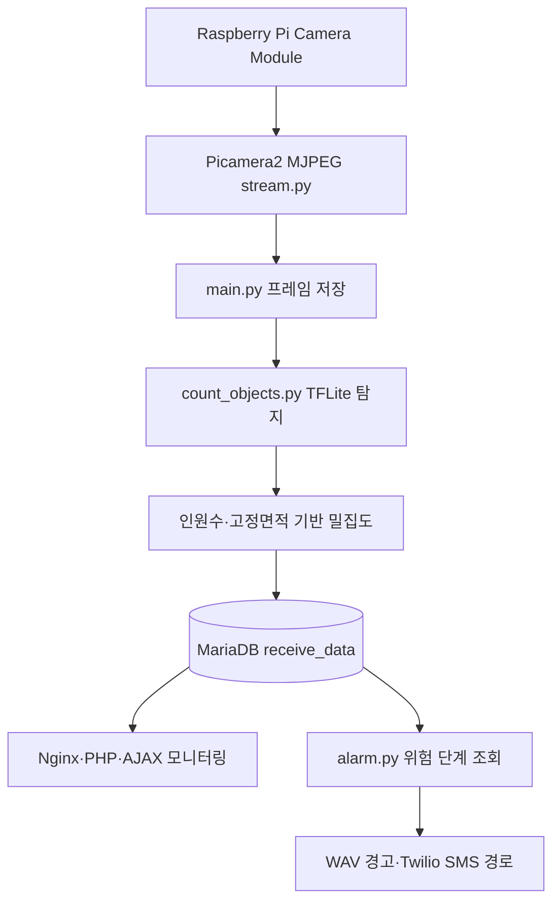
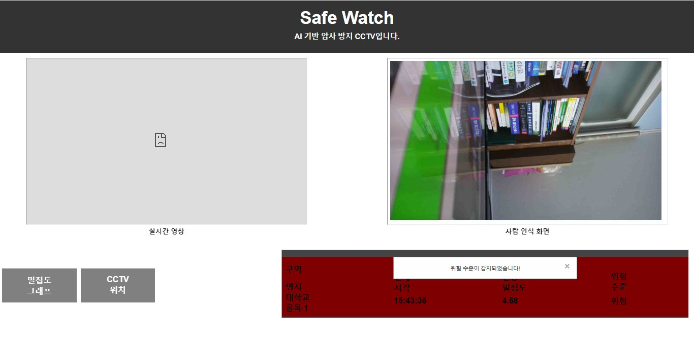

# Safe Watch — 2023 보관 원본 소스

**이 저장소의 `main`에는 2023년 프로젝트 당시 코드에 근거한 공개용 보관 소스만 남겼습니다.** 기존에 AI가 재구성한 Python/PHP/SQL, 테스트, 데모 코드는 `main`에서 제외했습니다. 2026년 작성한 README·근거 문서는 설명용이며 원본 소스라고 주장하지 않습니다.

## 근거와 우선순위

1. **최종 발표자료**: 실제로 구현했다고 발표한 기능과 단계 구분의 기준.
2. **2023 기반 공개용 보관 소스 16개**: 기존 보관 브랜치의 Git blob SHA가 일치하는 소스를 옮겼습니다. 단, 과거 공개 준비 과정에서 인증정보가 환경변수로 대체된 사본이므로 **2023년 비공개 원본 ZIP과 바이트 동일성은 주장하지 않습니다.**
3. **프로젝트 대화 및 사용자 확인**: 모델 변환 뒤 재학습·개조하지 않았으며, 면적은 고정 설정값, 이미지 파일은 덮어쓰기 방식임. **2026-10-31 최종 구현 추가 확인**: 인원 수 기준 3단계 위험 판정, 밀집도 백분율 변화율(%), `alarm.py`를 통한 SMS 발송, 10초 인식·DB 저장 주기.
4. **2026년 재구성 코드**: 원본이 확인되지 않는 기능을 추정해 작성한 별도 자료. 현재 `main`에는 포함하지 않음.

발표자료·사용자가 확인한 최종 동작과 보관 코드가 일치하지 않는 경우 **보관 코드를 임의로 고쳐 ‘원본’이라고 부르지 않고, 차이를 명시**합니다. 최종 위험 단계는 **인원 수 기준(1~2명 안전, 3~4명 경고, 5명 이상 위험)**으로 구현했다고 확인됐지만, 현재 보관된 `main.py`는 `인원 수 ÷ 고정 면적` 결과로 판정하므로 **확인된 최종 동작을 재현하는 최종 코드 파일 자체는 현재 보관본에서 확인되지 않습니다.**


## 사용자 확인: 2023년 최종 구현의 네 가지 확정 사항 (2026-10-31)

| 기능 | 최종 구현에 대한 사용자 확인 | 현재 보관 소스와의 관계 |
| --- | --- | --- |
| 위험 단계 | 사람 **인원 수** 기준: 1~2명 안전, 3~4명 경고, 5명 이상 위험 | 발표자료와 일치. 보관 `main.py`의 밀집도 기준 판정과 **불일치** |
| 밀집도 변화 그래프 | 직전 밀집도 대비 **백분율 변화율(%)** | 보관 `schema_legacy_percent.sql`과 일치. 개인 최종보고서의 절대 차이 SQL은 다른 버전 |
| 위험 SMS | **`alarm.py`가 발송** | 보관 `alarm.py`와 일치. 웹 `maininfo.html`의 별도 `/send_sms` 호출은 최종 발송 경로가 아님 |
| 사람 인식·DB 저장 주기 | **10초** | 2023 개인 최종보고서 `delay=10`과 일치. 보관 `configs.ini`의 `delay=15`는 다른 버전 |

이 네 항목은 **최종 구현에 관한 당사자 확인**이며, 누락된 최종판 소스·DB 로그를 새로 확보했다는 뜻이 아닙니다. 보관 코드·설정 파일은 수정하지 않았습니다. [코드와 발표 비교](docs/PRESENTATION_VS_SOURCE.md) · [대화·보고서 교차검토](docs/2023_CONVERSATIONS_AND_REPORT_AUDIT.md).

## 시스템 구성 (2023년 소스 연결 구조)



그림은 보존된 코드들의 **연결 의도와 구현 경로**를 설명합니다. 실제 SMS 수신은 별도 사진으로 확인됐으나, 실시간 카메라 위험값이 그 SMS를 발생시켰는지는 미확인입니다.


## 2023년 Safe Watch 실제 웹 화면



위 이미지는 **Safe Watch 웹 모니터링의 2023년 캡처본**으로, 당시 대시보드에 사람 인식 화면과 위험 경고 모달 등이 배치됐다는 증거입니다. 다만 이 화면의 위험값은 별도의 DB 시험·시연과 구분하여 해석하며, 실제 군중 밀집 상황에서 자동으로 모든 기능이 작동했다는 증명은 아닙니다.

**증거 분류 정정:** 이전에 이 저장소에 올렸던 두 `after.jpg` 검출 화면은 Safe Watch의 인식 코드를 **라인트레이서에 추출·적용하던 개발 과정**의 스크린샷입니다. 해당 자료는 [라인트레이서 저장소의 재사용 시험 기록](https://github.com/hsw-dotcom/human-aware-line-follower/blob/main/docs/DETECTOR_REUSE_EVIDENCE.md)으로 이동했습니다. Safe Watch의 직접 시연 증거로 사용하지 않습니다.

## 실제 원본 코드 배치

```text
src/
  python/
    main.py             # 영상 프레임 획득, 사람 수/밀집도, DB 저장
    count_objects.py    # TFLite 추론, after.jpg 덮어쓰기
    stream.py           # Picamera2 MJPEG
    alarm.py            # 위험 단계 조회, 10초 단위 경고음/Twilio
    configs.ini         # 보관 사본 delay=15, total_area=300 (최종 실제 인식·저장은 10초로 사용자 확인)
  web/
    index.html          # 메인 페이지
    image.php           # 내부 내용은 HTML, after.jpg 2초마다 갱신
    maininfo.html
    maininfo.php
    density.html
    densityinfo.php
    change.html
    changeinfo.php
    graph.html
    map.html
database/
  schema_legacy_percent.sql
docs/
  ORIGINAL_SOURCE_MANIFEST.md  # 각 파일의 2023 보관본 Git blob SHA
  PRESENTATION_VS_SOURCE.md    # 최종 발표와 실제 코드의 충돌·범위
  RECOVERY_STATUS.md           # 결손·제외 사항과 보존 브랜치
  attribution.md               # 팀 및 공개 예제 저작자 표기
```

**16개 코드·설정 파일을 기존 공개용 Git 보관본과 동일한 blob SHA로 보존**했습니다. 원본 개발 기능을 새로 설계·구현한 것이 아니며, 인증정보 비공개 처리는 별도의 공개용 변경으로 간주합니다. 여러 웹 페이지는 당시 원본의 분리된 구성으로, 기능을 임의 통합하지 않았습니다.

## 2023년 프로젝트 대화·최종보고서 재점검

2023년 Q&A와 2023-06-05 개인 최종보고서를 보관 원본 및 최종 발표자료에 다시 대조했습니다. **코드를 임의 재작성하지 않았고**, 자료 사이에서 확인되는 `delay=10`/보관 `delay=15`, 인원 수·면적 함수 인자 차이, 변화율 **절대차/퍼센트 SQL** 차이와 야외 시험의 한계를 기록했습니다. **최종 동작은 사용자 확인에 따라 10초 주기·인원 수 기준·백분율 변화율·`alarm.py` 발송으로 판정**하며, 이전 소스 버전 차이는 그대로 보존합니다.

[대화·보고서 재대조 및 누락 근거 목록](docs/2023_CONVERSATIONS_AND_REPORT_AUDIT.md) — 원본 코드와 후대 재구성 코드의 경계 포함.

## 복구 수준: 코드 구조는 있지만 완전한 실행 패키지는 아님

코드로 확인 가능한 단계: Pi MJPEG → 이미지 캡처 → TFLite 사람 검출 → 고정 면적 기반 밀집도 → MariaDB → Nginx/PHP/AJAX 웹·차트·지도 → DB 조회 기반 경고음/SMS.

**별도 비공개 백업에서 확보한 자산**: `people_detect.tflite`, `people_label.txt`, `warning.wav`. GitHub 공개 저장소에는 포함하지 않았습니다. 현재 통합 재실행에는 Raspberry Pi, 실행 환경·설정, 적법한 인증정보 등이 필요합니다. Flask `/send_sms` 호출을 담당할 당시 `app.py` 원본도 확보되지 않았습니다(독립적인 `alarm.py` Twilio 호출은 확인됨). 원본 SQL에는 실행 전 준비가 필요한 내용이 있습니다. 자세한 사항은 [복구 상태](docs/RECOVERY_STATUS.md) 참고.

2023년 휴대전화 화면에서 **Twilio 위험 알림 문자의 실제 수신**을 확인했습니다. 카메라가 감지한 실제 위험으로 발송된 것인지는 미확인입니다. [보유 자산 및 SMS 검증 기록](docs/ARTIFACT_AND_SMS_EVIDENCE.md)을 참고하세요.

현재 목적은 **하드웨어 없이 당시 소스를 보존하고 설명하는 것**이므로 하드웨어 구동, 실측 정확도 또는 실제 서비스 완전 동작을 주장하지 않습니다.

## 원본과 재구성본의 분리

- 현행 **원본 중심 `main`**: [저장소 루트](https://github.com/hsw-dotcom/safe-watch-crowd-monitoring)
- **정리 이전의 원본 + 재구성본**: [archive/pre-dedup-20261031](https://github.com/hsw-dotcom/safe-watch-crowd-monitoring/tree/archive/pre-dedup-20261031)
- **최종 발표 우선으로 수정했던 복원본**: [archive/reconstruction-before-original-only-20261031](https://github.com/hsw-dotcom/safe-watch-crowd-monitoring/tree/archive/reconstruction-before-original-only-20261031)

위 보관 브랜치 2개는 2026년 10월 31일 기존 커밋으로 복구했습니다. 과거 재구성 코드는 해당 브랜치에서 확인 가능하며 `main`에 혼입하지 않습니다.

> 출처 제한: 확인된 16개 소스가 2023년 최종 배포 파일 전체인지는 확정되지 않았습니다. **blob SHA 일치는 기존 Git 보관본과의 일치**만 보여줍니다. [원본/보안 사본 구분](docs/ARTIFACT_AND_SMS_EVIDENCE.md) 및 [발표·코드 차이](docs/PRESENTATION_VS_SOURCE.md)를 함께 확인하세요.

## 실행하지 않는 자동 검사

[GitHub Actions — Source syntax checks](https://github.com/hsw-dotcom/safe-watch-crowd-monitoring/actions/workflows/offline-checks.yml)는 Python 구문 컴파일과 PHP CLI가 있을 때의 PHP 문법 검사를 수행합니다. **카메라·DB·TFLite·경고음·SMS의 실제 작동을 검증하지 않습니다.**
